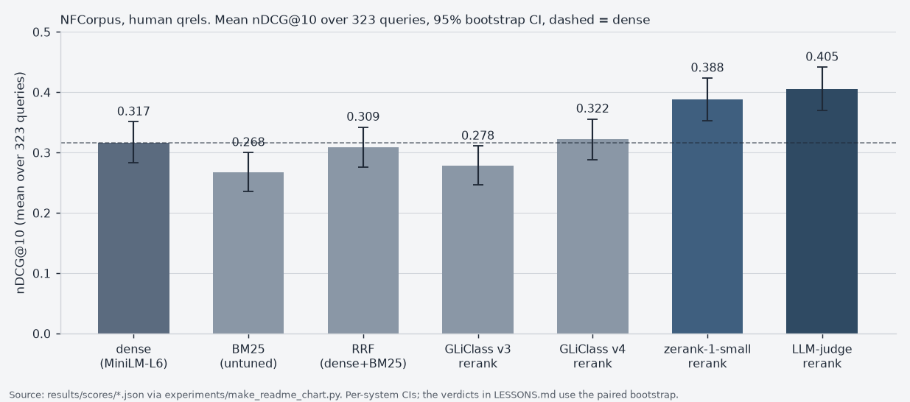

# rag-retrieval-lab


%2C%20323%20queries-3f5f7f)


**Retrieval methods, explained by running them: predictions written down first.**
**The case with receipts (frozen write-up): [`SHOWCASE.md`](SHOWCASE.md).**

Every RAG tutorial shows you hybrid search, RRF fusion, and an LLM reranker, then tells
you they help. This repo runs each one on a real benchmark and reports what actually
moved, including when the answer is "nothing".

Built from experiments originally run on a production investor-matching system, re-run
here on [NFCorpus](https://huggingface.co/datasets/BeIR/nfcorpus) so you can execute
every claim yourself.



## Results

Recomputed from the committed per-query score files (`results/scores/*.json`, 323
queries, human qrels) by `experiments/make_readme_chart.py`; the same numbers are in
[`LESSONS.md`](LESSONS.md). Deltas are paired bootstrap against the dense baseline,
10,000 resamples, 95% CI.

| method | nDCG@10 | Δ vs dense (95% CI) | recall@10 | recall@50 |
|---|---|---|---|---|
| dense (MiniLM-L6, title+text) | 0.3167 | baseline | 0.1550 | 0.2508 |
| BM25 (untuned, see note) | 0.2678 | −0.049 (−0.072 to −0.027), p ≈ 0 | 0.1241 | 0.1792 |
| RRF (dense + BM25) | 0.3093 | −0.007 (−0.024 to +0.009), null | 0.1477 | 0.2521 |
| zerank-1-small rerank of the dense top-50 | 0.3881 | +0.071 (+0.055 to +0.089), p ≈ 0 | 0.1819 | 0.2508 |
| LLM-judge rerank of the dense top-50 | **0.4052** | +0.089 (+0.071 to +0.106), p ≈ 0 | 0.1865 | 0.2508 |

Note on BM25: the index is built with `.lower().split()`, no stemming, no stopword
list and no punctuation stripping (`ragexp/retrieve.py`). Over the 323 test queries,
73 of the 1,064 query tokens start or end with a non-alphanumeric character, such as
`cancer?`. A token like that matches only an identically punctuated document token.
The 0.2678 is a ceiling for that preprocessing, not a
verdict on BM25. Note on recall@50: the two rerankers permute the dense top-50, so their
recall@50 is identical to dense by construction; recall@10 moves because the reranker
changes which of those 50 reach the top-10.

---

## The rule: predict first, then run

Every notebook **states its prediction and the mechanism behind it before running the
experiment**. Then it runs and reports what happened, including when the prediction was
wrong. That is the whole method. A prediction written down afterwards is a story rather
than a prediction.

This matters because the source system's results **do not automatically transfer**. It
ran on 1,147 investor profiles with a specific lexical field; NFCorpus is bio-medical
abstracts. Some mechanisms carry over, some don't, and the difference is the lesson.

- **A mechanism that should transfer.** If your query and your document are embedded by
  the *same model*, they already live in the same space. An adapter exists to fix
  cross-space misalignment. There isn't any here, so training one can't help. That
  argument doesn't mention the corpus, so it should hold. (Notebook 05, prediction:
  null.) The source system had already measured this null: its trained adapter did
  not beat a mean-pool blend. So notebook 05 tests whether a known null replicates;
  it is not an independent bet. Its pooling arm reuses that system's blend (¼ title,
  ¾ pooled body) unchanged, with no tuning for NFCorpus.
- **A result that probably won't transfer.** RRF fusion *hurt* recall on the source
  system. But BM25 is strong on domain-specific terminology, which is exactly what
  NFCorpus is made of. RRF is also widely reported to help on BEIR-type data. The
  original null may have been a fact about that corpus, not about RRF. (Notebook 03,
  prediction: genuinely unsure, and that's the honest answer)

All seven notebooks have run, and the predictions for notebooks 03 to 07 have all
**resolved**. The notebooks carry the numbers and the readings.

## The dataset

**NFCorpus** is BEIR's bio-medical retrieval set, chosen deliberately:

| property | value | why it matters |
|---|---|---|
| corpus | 3,633 docs | embeds in <1 min on a laptop; every notebook re-runs from scratch |
| queries | 323 (judged) | enough for a paired bootstrap to say something |
| judgments | 12,334 (~38/query) | densely judged; you can tell "not retrieved" from "not judged" |
| grades | 1 and 2 (+ implicit 0) | **graded, not binary**: nDCG and learning-to-rank need this |
| doc structure | `title` + `text` | lets notebook 05 ask summary-vs-body, the real RAG question |

Most BEIR sets are binary. SciFact ships 339 judgments *all scored 1*, so nDCG
degenerates and LTR is impossible. Picking the dataset is part of the method, so it
gets a table.

## Notebooks

Each one: a concept, a **prediction with a mechanism**, an experiment, and whatever
actually happened. In order.

| # | Notebook | Concept | Prediction (as pre-registered) | Outcome |
|---|---|---|---|---|
| 01 | `the-ruler` | recall@k, nDCG@k, paired bootstrap | *No prediction; this builds the instrument.* Shows why undefined must be `None` not `0.0`, and why two overlapping CIs don't mean "no difference" | ✅ run; both demos land (zero-poisoning understates 40%; paired p≈0 where independent CIs overlap) |
| 02 | `dense-baseline` | embed, rank by cosine | *No prediction; this is the bar.* | ✅ run; nDCG@10 0.317; per-query scores committed |
| 03 | `lexical-and-fusion` | BM25, Reciprocal Rank Fusion | **Unsure.** Hurt on the source system; BM25 should be strong on bio-medical terminology, so it may help here. Genuinely open | **Resolved:** BM25 loses to dense everywhere (with the caveat that BM25 here is untuned: `.lower().split()`, no stemming or stopwords, no punctuation stripping, so this is a preprocessing ceiling, not a verdict on BM25); **RRF nulls vs dense**: the source system's null transferred. Fusion only beats the weaker parent |
| 04 | `reranking` | LLM reranker, off-the-shelf reranker | **nDCG rises, recall@50 doesn't move.** Reranking permutes a fixed 50-doc pool, so it cannot change which docs are in the pool. recall@10 can move, because reranking changes which pool docs reach the top-10 | **Held, both halves:** nDCG@10 0.317→0.405 (LLM, p≈0) / 0.388 (zerank); recall@50 frozen bit-for-bit at 0.2508; recall@10 moved +0.032 (LLM) / +0.027 (zerank). Bonus: judge grading its own homework scores a meaningless 1.0. Third arm (GLiClass, pre-registered 2026-10-29): **half failed**, 0.278, below dense (−0.039, CI below 0) |
| 05 | `pooling-vs-summary` | title-embed vs chunk-pooling; trained adapter | **Pooling helps** (the body carries signal the title doesn't). **Adapter nulls**: same encoder, nothing to align | **Split:** pooling helps held against title-only: chunk-pool nDCG@10 +0.0255 (p=0.0002). It nulled against `dense` (title+text) on all three metrics over 323 queries. Adapter nulls held on the 107 held-out queries: nDCG@10 -0.0063 (p=0.28), though recall@50 -0.0245 (p=0.0112) is a significant loss |
| 06 | `learning-to-rank` | XGBoost / LambdaMART on MSLR-WEB10K | **LambdaMART beats the best single feature** on Fold 1 test nDCG@10 (paired-bootstrap CI excludes 0). Refined on 2026-10-29, before running, from the first wording "LambdaMART wins", which named no baseline. A published null exists ([Elsevier](https://github.com/elsevierlabs-os/build-ltr-models-using-llm)) but it used LLM-generated labels; MSLR has no text to relabel, so that question stays a caveat | **Held:** test nDCG@10 0.327 (best feature, picked on vali) → 0.492 (LambdaMART), +0.165, CI [+0.155, +0.175], p ≈ 0, 1,928 defined test queries. One fold, fixed settings |
| 07 | `contextual-retrieval` | chunk text: plain vs title-prefixed vs LLM context line (Claude Haiku) | **The LLM context line beats plain chunks, but not the title.** Arm 3 vs arm 1 paired nDCG@10 CI above 0; arm 3 vs arm 2 CI includes 0. Pre-registered 2026-10-29, before any context line was written | **Failed, first half:** arm 3 (Haiku context) vs arm 1 (plain) nDCG@10 +0.0051, CI [−0.0011, +0.0117], p = 0.11. Second half held: vs arm 2 (title) +0.0025, CI includes 0. Every chunk arm ties title+text dense (0.3167): 0.3140 / 0.3166 / 0.3191 |

### The thread running through all of them

**Notebook 04 is the spine.** Suppose an LLM writes your relevance labels, an LLM
reranks your results, and the score goes up. Did the system improve, or did the judge
agree with itself?

A better prompt does not answer that. A measurement the optimizer *cannot* game
does. Reranking only reorders a fixed candidate pool, so it cannot change which
documents are in the pool. **recall at the pool depth (recall@50 here) is therefore
immune to reranker self-agreement.** recall@10 is not: reranking changes which pool
docs reach the top-10, and it did move (+0.032 for the LLM judge). Any movement in
recall@50 has to come from somewhere real, or from a bug.

Find a measurement the thing being tested can't influence. That idea is the whole repo,
and it generalises well past retrieval.

## Setup

```bash
pyenv virtualenv 3.12.9 rag-retrieval-lab && pyenv local rag-retrieval-lab
pip install -r requirements.txt
python -c "from ragexp.data import load_nfcorpus; print(load_nfcorpus().summary())"
# NFCorpus: 3633 docs, 323 queries, 12334 judgments (38.2/query), grade distribution {1: 11758, 2: 576}
```

`requirements.txt` caps torch below 2.15. On macOS 14, torch 2.15.0 aborts when
a model encodes on the Apple GPU (MPS); 2.14.1 passes the full test suite there. Linux is not
affected, so the cap can go once a later torch passes on macOS 14.

Notebook 06 needs MSLR-WEB10K, which you download by hand from Microsoft Research's MSLR
page. Its licence does not allow redistribution, so it is not in this repo. The notebook
reads Fold 1 from `~/data/mslr-web10k/extracted/Fold1`, or from the path in the
`MSLR_FOLD` environment variable.

No notebook needs an API key. Notebook 04's LLM judge ran through headless Claude Code
(`claude -p`, subscription login, see `ragexp/rerank.py`), and its grades are committed to
`results/rerank/`, so everything downstream reproduces without re-running it.

Provenance of the judge row: the grades were committed on 2026-08-15 and came through the
CLI's `opus` alias (Claude Opus; the exact model version behind the alias was not
recorded). The 0.4052 figure reproduces from the committed grades; the grades themselves
cannot be regenerated against the same model, since the alias moves. The zerank row can
be re-run locally against the named checkpoint `zeroentropy/zerank-1-small` (not
revision-pinned).

## Layout

```
ragexp/          the library: importable, unit-testable, no notebook magic
  metrics.py     recall@k, nDCG@k, paired bootstrap        [done]
  data.py        NFCorpus loader                            [done]
  embed.py       sentence-transformers wrapper              [done]
  retrieve.py    dense / bm25 / rrf / pooling               [done]
  runs.py        per-query scoring + committed score files  [done]
  rerank.py      LLM judge + off-the-shelf reranker         [done]
notebooks/       the teaching layer: narrative, plots, lessons (all seven run)
experiments/     scripts that produce the committed numbers
results/         committed snapshots (so notebooks don't need to re-run everything)
tests/           pytest suite (81 tests; `-m integration` needs local HF caches)
LESSONS.md       every experiment: what / number / verdict / lesson  [done]
```

Logic lives in `ragexp/`, not in notebook cells. Notebooks import it. That way the
claims are testable and the notebooks stay readable.

## Status

All seven notebooks have run. The library is tested. The notebooks are executed with
outputs committed. Every open prediction resolved. 03 has RRF nulling against dense.
04 has nDCG rising while recall@50 stays frozen, as it structurally must. 05 splits:
pooling beats title-only but nulls against dense, and the adapter nulls. 06 has
LambdaMART beating the best single feature. 07 has LLM-written context lines
nulling against plain chunks, and every chunk arm tying dense.

Notebook 04's LLM-judge grades and zerank scores are committed under
`results/rerank/`, so everything reproduces without an API key or a GPU.

All seven notebooks have run. `LESSONS.md` and its predictions→results table cover all seven.

### Next (filed 2026-09-21)

**Notebook 04, third reranker arm: GLiClass. Pre-registered 2026-10-29 (`bdc024b`), run the same day.**
[`knowledgator/GLiClass`](https://github.com/Knowledgator/GLiClass) (Apache-2.0) is a zero-shot
classifier: it scores one text against a list of labels. Its paper claims ~10× a cross-encoder at
comparable quality. Setup, fixed before running: `knowledgator/gliclass-modern-base-v3.0`, one pass
per (query, doc) pair, with the doc as the text (cut to 1,200 chars, zerank's cut) and the query as
the only label. The score is that label's probability. Same 50-doc dense pool, same 323 queries,
`paired_bootstrap` in corpus order. Scores go to `results/rerank/gliclass_scores.json`.
**Prediction: GLiClass beats the dense baseline (paired nDCG@10 CI above 0) but loses to zerank
(paired CI against zerank below 0).** A base-size zero-shot classifier should not match a 1.7B model
trained to rank. Falsified if either CI includes 0 or lies on the other side. Structural check:
recall@50 bit-identical at 0.2508. The one-pass mode behind the speed claim (query as text, the 50
docs as labels) is not tested; wall-clock time is recorded.
**Result: half failed.** GLiClass scored nDCG@10 0.2781, *below* the dense pool it reorders
(−0.0386, CI [−0.0601, −0.0177], p = 0.0004), and below zerank (−0.1100). It is not a broken
harness: a random shuffle of the pools scores 0.114. See the end of notebook 04.

**Notebook 04, fourth reranker arm: GLiClass v4. Pre-registered 2026-10-29, before any NFCorpus pair
was scored.** The literature check after the v3 run (end of notebook 04) found that v3 had no retrieval
training. [`knowledgator/gliclass-v4-edge`](https://huggingface.co/knowledgator/gliclass-v4-edge)
(0.4B, Apache-2.0, released 2026-10-16) is the first public GLiClass whose card shows reranking, with
an instruction prompt. Setup, fixed before running: the same 50-doc dense pools, one pass per
(query, doc) pair, the doc as the text (cut to 1,200 chars, as for zerank and v3), the query as the
only label, the card's prompt `"Does the passage answer the query?"`, threshold 0, ties broken by
dense order. Scores go to `results/rerank/gliclass_v4_scores.json`.
**Prediction: GLiClass v4 beats the dense baseline (paired nDCG@10 CI above 0) but loses to zerank
(paired CI against zerank below 0).** Falsified if either CI includes 0 or lies on the other side.
Reported, not bet on: v4 against v3, recall@10, and recall@50 bit-identical at 0.2508. Known
confound: the checkpoint and the prompt both change from v3, so a win cannot be split between them.

**A hosted explainer.** `SHOWCASE.md` is the frozen write-up; the sibling repo
[rlvr-codegen](https://github.com/Michiel-DK/rlvr-codegen) hosts the same kind of page on GitHub
Pages (`testing-the-tests.html`) and links it from its README. Do the same here from `SHOWCASE.md`
plus the GLiClass row once it exists. It is the page the roger3000 site will link as its third
proof tile ("we test retrieval methods before we sell them; here is what did nothing").
Quote only numbers scored against the human qrels; never the judge-labelled 1.0000 as a result.

